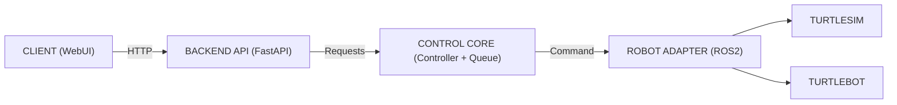

# Robot Control System (Backend)

Backend for controlling a ROS2 robot (TurtleBot) or a simulation (turtlesim). The backend provides a REST API (FastAPI) and is consumed by a Web UI.

- Backend (this repo): FastAPI + ROS2 HAL + STT/TTS
- Frontend/Web UI (separate repo): https://projectbase.medien.hs-duesseldorf.de/dsai/tftb/take-control/web-ui

## What is implemented?

- **REST API** for movement/stop commands, photo, dock/undock, status/battery/map/nav-status
- **Command queue** (non-blocking): API accepts, worker executes, emergency stop clears the queue
- **State streaming** for the UI (SSE): `GET /api/v1/state/stream`
- **STT** (Vosk/text) → **intent parser** (rule-based) **or** **AI function calling** (Ollama) → command queue
- **TTS** for voice feedback/confirmations (used by the backend, e.g. during STT execution)

## Project notes / status

- Default mode is `INTENT_MODE=parse` (rule-based intent parser).
- To use **AI function calling**, set `INTENT_MODE=function_calling`.
- AI function calling uses **Ollama** and expects the model to return **JSON only** (see the JSON format described in the prompt in `backend/app/api/v1/function_calling.py`).
- The currently configured Ollama model in code is `llama3:8b` (must be installed locally, e.g. via `ollama run llama3:8b`).
- If AI function calling fails at runtime (e.g. Ollama not reachable / invalid JSON), the backend falls back to the rule-based intent parser.

---

## System Architecture



---

## Quickstart (Backend + Frontend)

### 1) Configure the backend

On startup, the backend automatically loads `backend/.env` (if present).

1. Copy `backend/.env.example` to `backend/.env`
2. Set `ROBOT_BACKEND`:
   - `sim` = turtlesim
   - `real` = TurtleBot

Minimal example:

```dotenv
ROBOT_BACKEND=sim
```

### 2) Start the backend

**Prerequisites (for real robot control):** ROS2 is installed and your environment is sourced so that `import rclpy` works.
Without ROS2, the backend may still start (e.g. `/docs`), but robot calls will fail.

#### Windows (PowerShell) / Linux (shell) – Python venv

From the repo root:

```bash
cd backend
python -m venv .venv
```

Activate:

- Windows (PowerShell):

```powershell
.\.venv\Scripts\Activate.ps1
```

- Linux/macOS/WSL:

```bash
source .venv/bin/activate
```

Install dependencies:

```bash
pip install -r requirements.txt
```

Start the server (recommended):

```bash
python -m app.main
```

API docs:

- Swagger UI: http://127.0.0.1:8000/docs
- Health: http://127.0.0.1:8000/api/v1/control/health

#### Linux shortcut (ROS2 + venv)

If you use ROS2 Jazzy on Linux, you can also use the helper script:

```bash
./backend/run_backend.sh
```

### 2a) STT/TTS + AI function calling prerequisites

To run the system as intended (voice → intent → robot + voice feedback), additional dependencies are required. This is especially relevant if you want to use `INTENT_MODE=function_calling`:

- **STT (Vosk)**: a Vosk model (`STT_MODEL_PATH`) and—for live microphone input—an audio input, typically via `arecord` (on Windows usually via WSL2)
- **AI function calling**: running **Ollama** + an installed model (e.g. `llama3:8b`) if `INTENT_MODE=function_calling` is used
- **TTS**: at least one engine available (`pico2wave` + player `paplay/aplay`, or `spd-say`, or `espeak/espeak-ng`)

### 3) Start the frontend/Web UI

The Web UI is in a separate repository:

- https://projectbase.medien.hs-duesseldorf.de/dsai/tftb/take-control/web-ui

Follow the setup steps there. Important: the UI must be able to reach the backend at `http://127.0.0.1:8000`.

## API – key endpoints

All endpoints are documented in `/docs`. Commonly used:

- `GET /api/v1/control/health`
- `POST /api/v1/control/command` → `{"command":"forward 1.5 0.5"}`
- Dock/undock also uses `POST /api/v1/control/command` with `{"command":"dock"}` or `{"command":"undock"}`
- `POST /api/v1/control/stop`
- `GET /api/v1/control/photo`
- `GET /api/v1/control/dock_status`
- `GET /api/v1/state/snapshot`
- `GET /api/v1/state/stream` (Server-Sent Events)

For manual tests there is [backend/test_api.http](backend/test_api.http) (e.g. with the VS Code REST Client).

## STT (Speech-to-Text) + intent

The backend provides STT endpoints as well as a live loop (Vosk + `arecord`) and processes text via the intent parser or AI function calling.
If AI function calling fails at runtime (e.g. Ollama not reachable / invalid JSON), the backend falls back to the rule-based intent parser.

- `POST /api/v1/stt/parse` (derive intent only)
- `POST /api/v1/stt/execute` (derive intent + enqueue command)
- Live STT (microphone): `POST /api/v1/stt/live/start`, `POST /api/v1/stt/live/stop`, `GET /api/v1/stt/live/status`

Important env vars:

- `INTENT_MODE=parse` (intent parser) or `INTENT_MODE=function_calling` (AI function calling via Ollama)
- `STT_MODEL_PATH` (Vosk model)
- `STT_DEVICE`, `STT_SAMPLE_RATE`
- `WAKE_WORD`, `WAKE_TIMEOUT_S`
- `STT_DEFAULT_LINEAR`, `STT_DEFAULT_ANGULAR`

Note:

- Even without a microphone/`arecord`, you can still send text directly to `POST /api/v1/stt/execute` (from the UI or via HTTP).

## TTS (Text-to-Speech)

- `POST /api/v1/tts/say`

Env vars:

- `TTS_ENABLED=1|0`
- `TTS_ENGINE=auto|pico2wave|spd-say|espeak`
- `TTS_PLAYER` (e.g. `paplay` or `aplay`, if pico2wave is used)
- `TTS_LANG` (default `de-DE`)

Note:

- The backend uses TTS for confirmations during STT execution. To temporarily disable it: `TTS_ENABLED=0`.

## Robot/ROS2 configuration (common)

- `ROBOT_BACKEND=sim|real`
- `CMD_VEL_TOPIC` (default `/cmd_vel`)
- `CMD_VEL_MSG_TYPE=TwistStamped|Twist` (default `TwistStamped`)
- `CMD_VEL_PUBLISH_UNSTAMPED=1|0` and `CMD_VEL_UNSTAMPED_TOPIC` (fallback for stacks that expect Twist)
- QoS: `CMD_VEL_RELIABILITY`, `CMD_VEL_DURABILITY`, `CMD_VEL_DEPTH`
- Camera: `CAMERA_TOPIC`, `OAKD_CAMERA_TOPIC`, `PHOTO_FORMAT=jpeg|png`, `PHOTO_MAX_WIDTH`, `PHOTO_JPEG_QUALITY`

## Troubleshooting

### Port 8000 is already in use

- Windows: `netstat -ano | findstr :8000`
- Linux: `ss -ltnp | grep ':8000'`

### ROS2 imports fail (`import rclpy`)

This almost always means: ROS2 is not installed or the ROS2 environment is not sourced.
On Windows, WSL2 (Ubuntu + ROS2) is often the easiest development setup.

## Tests / smoke checks

- HTTP API collection: [backend/test_api.http](backend/test_api.http)
- Simple parser/controller smoke test: [backend/test_backend.py](backend/test_backend.py)
- ROS2 turtlesim publish smoke test: [backend/test_ros2_turtlesim.py](backend/test_ros2_turtlesim.py)

## License

No license file is currently included in this repository.
